<div align="center">

# CINESIGHT-X

### Don't Just Watch. Experience.

**A cinematic seat-discovery platform combining personalized recommendations, interactive theater visualization, and immersive 3D point-of-view previews.**

Built with **Laravel 13 · React 19 · TypeScript · Inertia.js 3 · Three.js · React Three Fiber**

[Explore Features](#-the-experience) · [Technical Architecture](#-architecture) · [Tech Stack](#-technology-stack) · [Getting Started](#-getting-started) · [Security & Testing](#-security--quality-engineering)

</div>

---

## The idea

**What if choosing a cinema seat felt as intentional as choosing the movie?**

Most seat-selection interfaces show a grid and ask users to guess where they will feel most comfortable. CineSight-X explores a different experience: **discover preferences, receive seat recommendations, compare options, and preview a simulated view from inside the theater**—before deciding which position feels right.

This project is a **self-developed portfolio application and cinema seating simulator**, not a live movie-ticketing service. Seat status in the application is demonstration data; it must not be interpreted as real-world ticket availability. POV scenes are simulations, not guaranteed measurements of a particular commercial theater.

## ✨ The experience

| Experience | What it does |
| --- | --- |
| **Cinemaverse Portal** | A cinematic landing experience featuring theater-inspired visual design and an interactive seat overview. |
| **Holographic Seat Discovery** | Explore a **10-row × 18-seat (180 seats)** layout, select a seating zone, and indicate a viewing preference. |
| **Personalized Seat Recommendations** | Generate ranked seat suggestions using application-side recommendation logic and available demo seat data. |
| **Intelligence Reveal** | Review ranked recommendations and continue to POV or comparison views. |
| **Versus Experience** | Compare two seat positions and their displayed metrics side by side. |
| **Immersive Dimension** | Enter an interactive 3D theater scene and explore a seat-based simulated POV, including fullscreen presentation. |
| **Cinema Mission Control** | Restricted administrative dashboard for searching, filtering, enabling, or disabling demo seats. |
| **Audit Chronicle** | Review administrative seat changes, with server-backed history filtering/pagination and CSV/PDF export. |

### The user journey

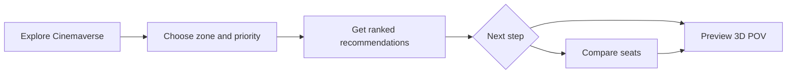

### Theater model

- **180 demo seats:** rows **A–J**, **18 seats per row**.
- **Row A** is farthest from the screen; **row J** is closest.
- Viewing zones and seating priorities let users explore different preferences.
- Recommendation results respond to seat availability flags maintained in the application's demo data.

## 🧠 Engineering highlights

### 1. Full-stack integration without a separate SPA API layer

CineSight-X uses **Laravel** for HTTP routing, controllers, validation, authentication, authorization, and persistence. **Inertia.js** connects server-side Laravel responses to **React** pages, while **TypeScript** makes the frontend easier to maintain as the experience grows.

Dedicated **read-only REST endpoints** also expose studio and seat data under `api/v1/` for the seating experience.

### 2. Interactive 3D visualization

**Three.js**, **React Three Fiber**, and **Drei** support the immersive cinema visualization. The project separates 3D scene components and cinema geometry utilities from the surrounding page interfaces, allowing the app to present detailed POV experiences alongside conventional React workflows.

The simulated perspective is a visualization feature, not a physically calibrated sightline guarantee.

### 3. Recommendation-oriented UI

The discovery flow combines zone preferences, viewing priorities, seat data, and ranking logic to present a shortlist rather than leaving users with only a seat map. The interface carries these choices into results, comparison, and POV exploration.

**Note:** The current project demonstrates application-defined recommendation logic; it does not claim a trained machine-learning model or clinical vision assessment.

### 4. Operational administration with accountability

Administrative seat changes are **validated server-side**, restricted to authorized users, and captured in audit records. Single-seat changes and mass activation run within **database transactions**, helping keep state changes and audit entries consistent.

## 🏗 Architecture

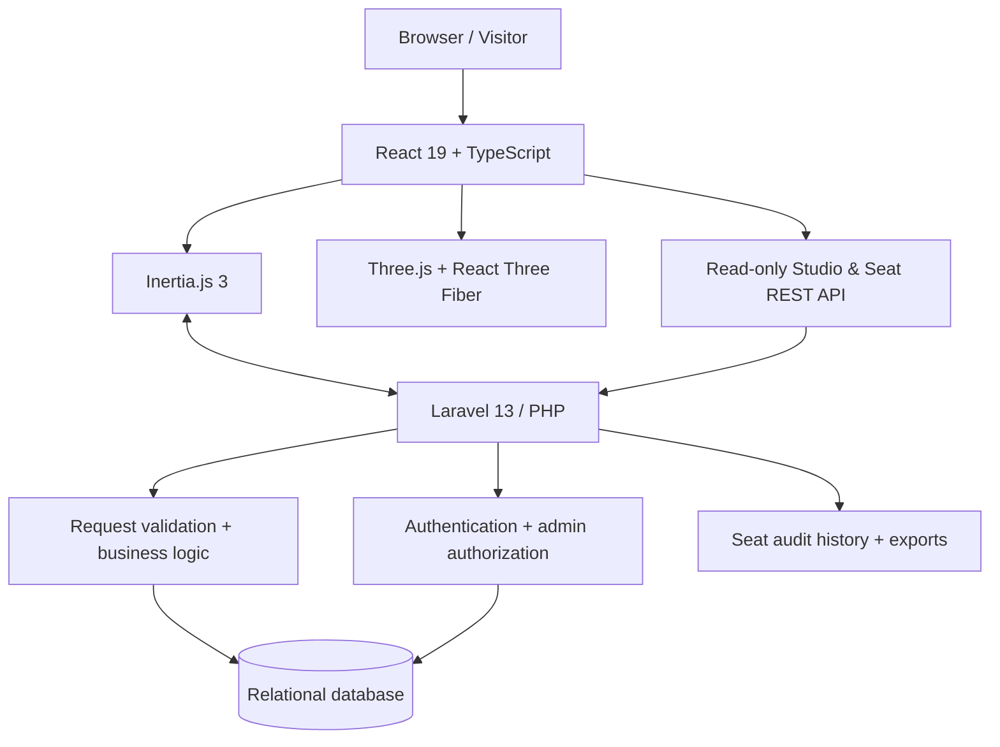

### Application routes

| Route | Responsibility |
| --- | --- |
| `/cinema` | Cinemaverse landing page |
| `/cinema/discover` | Seat discovery and preference selection |
| `/cinema/results` | Ranked recommendations |
| `/cinema/compare` | Seat comparison |
| `/cinema/experience` | Immersive theater / seat POV |
| `/cinema/admin` | Protected administration panel |

**Read-only API endpoints:**

```http
GET /api/v1/studios/{studio}
GET /api/v1/studios/{studio}/seats
GET /api/v1/studios/{studio}/seats/{seat}
```

The application also exposes **protected Admin routes** for seat status changes, mass activation, activity history, and CSV/PDF exports. Authorization is enforced on the server, not merely by hiding UI controls.

## 🛠 Technology stack

| Layer | Technologies | Purpose |
| --- | --- | --- |
| **Backend** | PHP 8.3+; Laravel 13 | Routing, controllers, request validation, persistence, business rules |
| **Frontend** | React 19; TypeScript | Component-based interfaces and type-safe application code |
| **Full-stack bridge** | Inertia.js 3 | Laravel-driven navigation with React-rendered pages |
| **3D experience** | Three.js; React Three Fiber; Drei | Interactive theater visualization, scene composition and POV |
| **Design system** | Tailwind CSS 4; Radix UI; Lucide React; custom CSS | Responsive layouts, accessible primitives, icons and cinematic styling |
| **Build tooling** | Vite Plus / Vite-compatible tooling; Laravel Vite plugin | Development and production asset builds |
| **Typed routing** | Laravel Wayfinder | Generated route/controller helpers for TypeScript |
| **Authentication** | Laravel Fortify; Laravel middleware | Authentication workflows and protected routes |
| **Exports** | Laravel DOMPDF; CSV responses | Administrative activity reporting |
| **Testing and analysis** | Laravel feature tests; Pest (dependency); TypeScript compiler; Larastan/PHPStan (configured) | Verification and static analysis tooling |
| **Database** | Laravel Eloquent + migrations; SQLite supported by project setup | Studio, seats, users and audit-log persistence |

**Dependency versions above are based on the project's `composer.json` and `package.json` as reviewed in November 2026.** Not every installed library is necessarily used in a user-facing CineSight-X feature.

## 🔐 Security & quality engineering

The application incorporates server-side protections for administrative operations:

- **Authentication:** Admin pages and mutation endpoints require a logged-in session (`auth` middleware).
- **Authorization:** Custom `EnsureCineSightAdmin` middleware checks the authenticated user's `is_admin` flag; unauthorized users receive **HTTP 403**.
- **Strict validation:** Seat status changes accept a required boolean value; seat identifiers are constrained to **A–J and 1–18**.
- **Protected bulk action:** Activating all inactive seats requires the explicit `ACTIVATE_ALL` confirmation value.
- **Transactions and auditing:** Changes and corresponding `SeatAuditLog` entries are handled in database transactions. No-op status changes do not create a new single-seat audit entry.
- **Feature-test coverage:** Test files cover admin access restrictions, seat mutations, audit history, pagination, and API behavior.

Security note: These are **implemented safeguards**, not a claim of an independent penetration test or production security certification. Always review environment settings, session security, rate limits, and access policy before public deployment.

### Quality snapshot

A local Lighthouse Mobile assessment of the **Discovery** page reported the following during development:

| Lighthouse category | Observed score |
| --- | ---: |
| Performance | **81 / 100** |
| Accessibility | **100 / 100** |
| Best Practices | **100 / 100** |
| SEO | **91 / 100** |

These are **development-environment observations**, not repeatable guarantees or scores for every route/device. The project's immersive 3D bundle may have different performance characteristics from the Discovery page.

## 🚀 Getting started

### Requirements

- PHP **8.3+** and Composer
- Node.js and npm (a modern Node release compatible with the installed toolchain)
- A configured database supported by Laravel (SQLite can be used for local development)

### Local setup

```bash
# Install dependencies
composer install
npm install

# Create local environment configuration
cp .env.example .env
php artisan key:generate

# Configure DB_* environment values in .env first,
# then run migrations
php artisan migrate
php artisan db:seed --class=CineSightStudioSeeder

# Build production frontend assets
npm run build
```

For development, start the Laravel application and frontend development tooling using your preferred local environment (the project was developed with **Laravel Herd on Windows**). Project scripts include `npm run dev`; the exact local host and database configuration depend on your environment.

> **Demo data:** Run `php artisan db:seed --class=CineSightStudioSeeder` after migrating to populate the demonstration studio with 180 seats (10 rows, 18 seats per row). Existing seat activation statuses are preserved when the seeder is rerun, while studio configuration values are updated.

### Verification commands

```bash
# Frontend type safety
npx tsc --noEmit

# Production bundle
npm run build

# Laravel tests
php artisan test

# Review cinema routes
php artisan route:list --path=cinema
php artisan route:list --path=api
```

Do not commit `.env`, secret keys, private credentials, or development database contents.

## 🎯 What this project demonstrates

CineSight-X was built to demonstrate capabilities across multiple disciplines:

**Full-stack development** — Laravel controllers and routes, React interfaces, TypeScript integration, Inertia navigation, relational persistence, and APIs.

**Interactive frontend engineering** — immersive 3D visualization, seat-map rendering, stateful preference flows, comparison interfaces, and responsive UI.

**Backend reliability and security** — validation, role-based admin gating, transactional mutations, audit trails, and feature testing.

**Product thinking** — turning an everyday selection problem into a preference-driven, visual decision journey.

## 🧭 Current scope and future opportunities

**Current scope:** A portfolio-grade seat recommendation and visualization demo with protected administrative controls. It is **not connected to cinema ticket inventory or checkout**.

Potential future directions include real venue-specific geometry, calibrated sightline measurements, performance refinements, user studies, and optional integrations with authorized theater data providers.

## 👩‍💻 Developer

**Dwi Nisyatul Wardah**  
Information Technology Graduate · Full-Stack Web Development · Interactive Web Experiences

*Designed and developed as a hands-on exploration of full-stack application architecture, immersive user interfaces, and secure administrative workflows.*

---

<div align="center">

**CineSight-X — Don't Just Watch. Experience.**

*From a seat grid to a cinematic decision experience.*

</div>

<!-- CINESIGHT_VISUAL_SHOWCASE_START -->

## Visual Showcase

> **Beyond Seat Selection. A Complete Cinema Experience.**
>
> CineSight-X combines spatial geometry, personalized recommendations,
> immersive 3D visualization, and database-backed administration
> into a cohesive full-stack application.

### 01 | Cinemaverse Portal

*Where the Experience Begins*

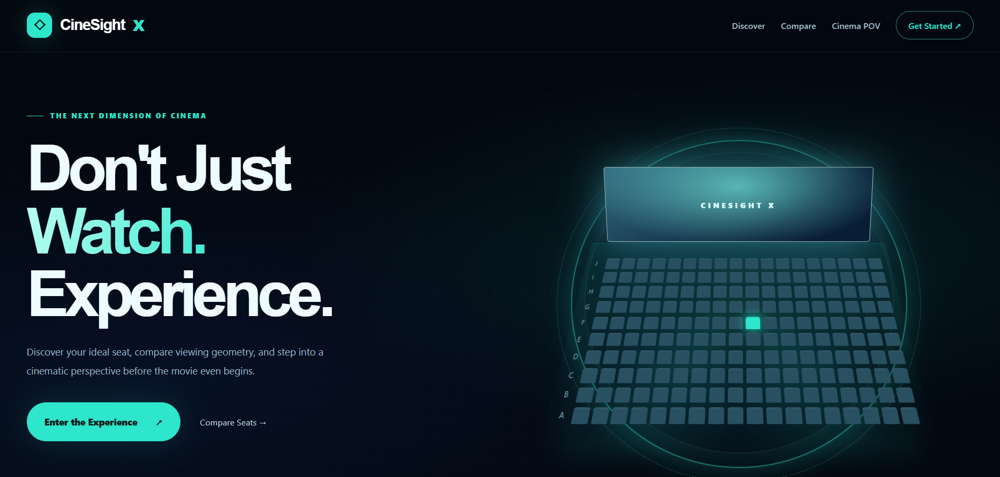

A cinematic entry point that transforms conventional cinema seat selection into an immersive digital journey. Built with React, TypeScript, and custom cinematic UI styling, the portal introduces an interactive cinema experience.

---

### 02 | The Experience Journey

*Discover. Compare. Experience.*

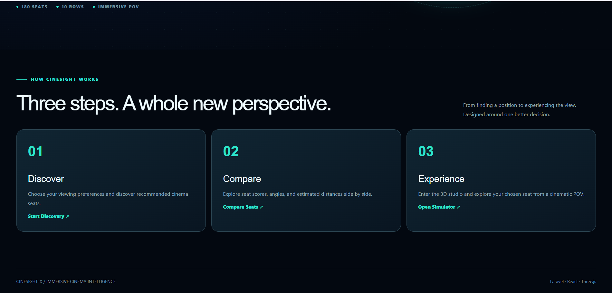

A guided three-stage workflow connects personalized seat discovery, side-by-side viewing comparisons, and interactive 3D exploration into one cohesive user experience.

---

### 03 | Intelligent Seat Discovery

*Designed Around Your Preferences*

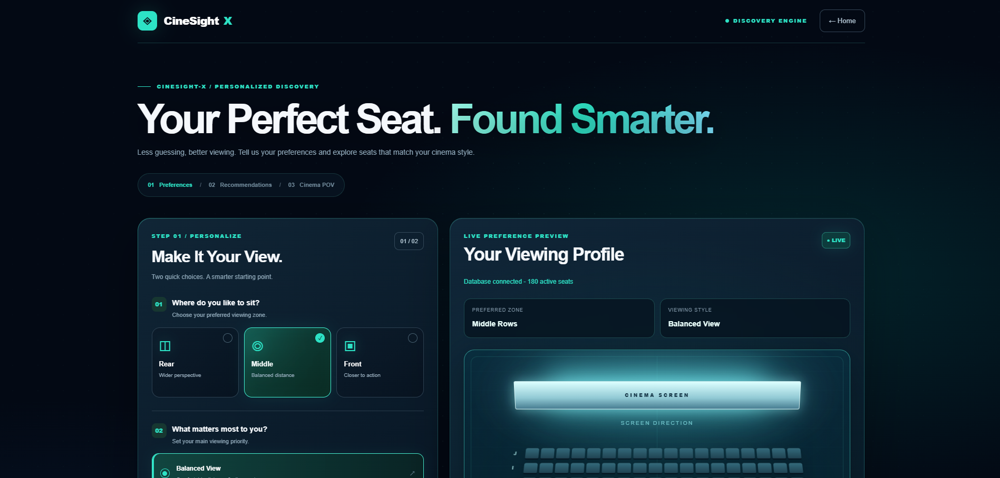

Users personalize their exploration by selecting seating zones and viewing priorities. These preferences guide the geometry-based recommendation process.

---

### 04 | Holographic Seating Map

*180 Seats. One Interactive Experience.*

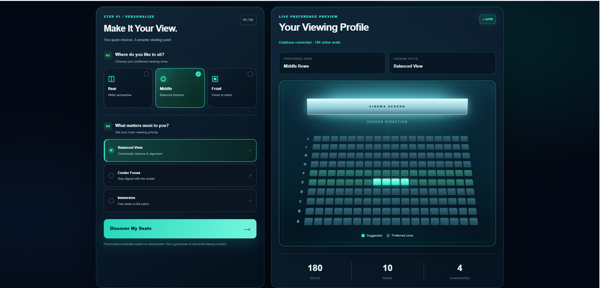

A cinematic seating visualization represents 180 seats across 10 rows, highlighting relevant zones and recommended positions using application seat-status data.

---

### 05 | Personalized Recommendation Engine

*From Preferences to Spatial Intelligence*

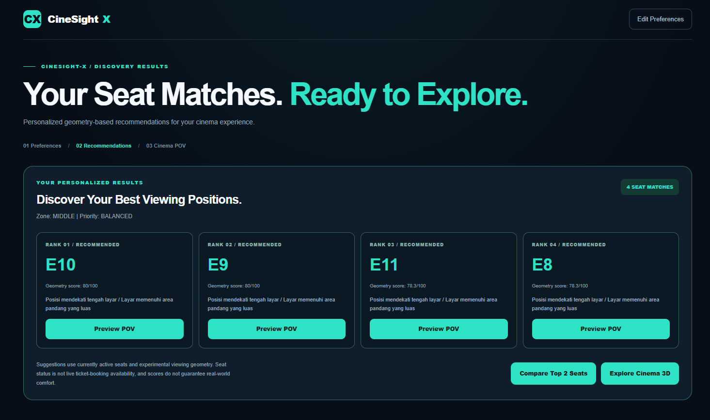

An experimental geometry-based recommendation engine ranks suitable viewing positions. Each recommendation includes a calculated score and supporting explanations.

---

### 06 | Smart Seat Comparison

*Two Positions. Different Perspectives.*

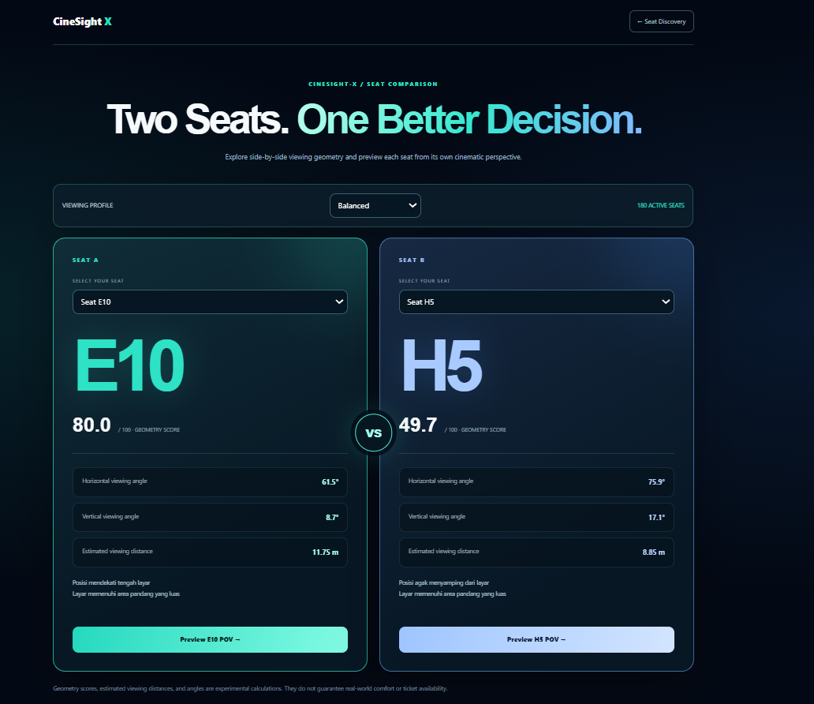

Compare seats using geometry scores, horizontal and vertical viewing angles, and estimated viewing distances. Users can evaluate contrasting positions and preview their respective 3D viewpoints.

---

### 07 | Immersive Dimension

*The Best View Starts Before the Movie*

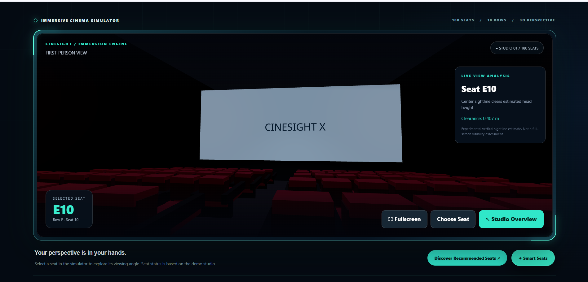

A cinematic gateway to interactive theater visualization, integrating React interfaces with Three.js and React Three Fiber for perspective-focused exploration.

---

### 08 | Interactive Cinema POV

*Experience the Theater Through Your Seat*

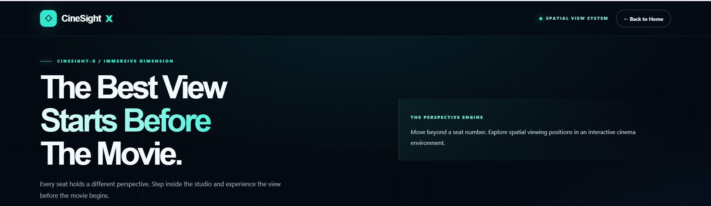

Explore selected cinema seating positions through an interactive 3D environment featuring seat navigation, camera transitions, fullscreen viewing, and perspective information.

---

### 09 | Cinema Mission Control

*Centralized Cinema Administration*

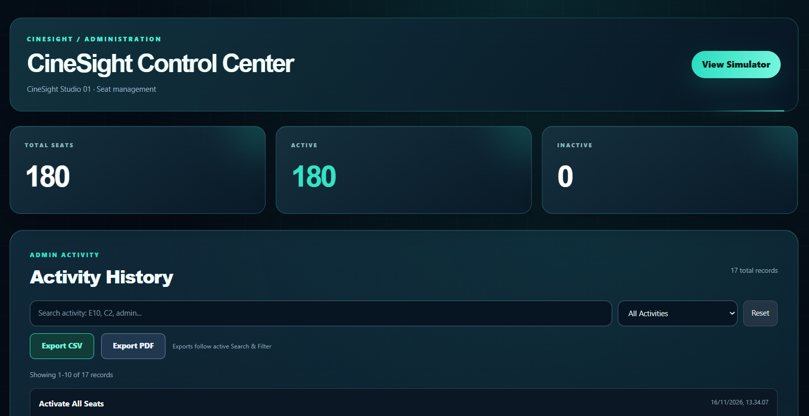

A database-backed operational dashboard provides seat-status summaries and administrative controls. Access is protected through Laravel authentication and administrator authorization.

---

### 10 | Audit Chronicle

*Every Change Tells a Story*

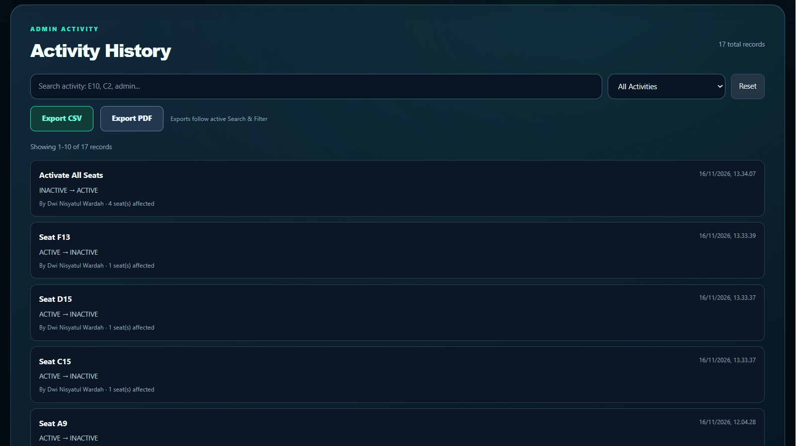

An administrative audit history tracks seat-status changes and bulk operations. Authorized administrators can search, filter, and export records in CSV and PDF formats.

---

### 11 | Seat Management

*180 Seats. One Control Center.*

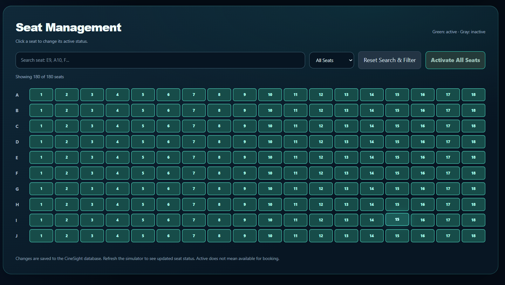

Manage seat status through a structured dashboard with search, filtering, individual updates, and confirmed bulk activation. Server-side validation, database transactions, and audit logging support operational integrity.

---

### Engineering Behind the Experience

- **Frontend:** React 19, TypeScript, Inertia.js, and responsive cinematic UI.
- **Backend:** Laravel 13, PHP, controller-based architecture, and REST APIs.
- **3D Visualization:** Three.js, React Three Fiber, and Drei.
- **Recommendation System:** Preference-driven geometry scoring.
- **Database:** Eloquent ORM, studios, seats, users, and audit logs.
- **Security:** Authentication, admin authorization, and input validation.
- **Administration:** Seat management, database transactions, and CSV/PDF reporting.
- **Testing:** Laravel feature tests, TypeScript checks, and production builds.

<!-- CINESIGHT_VISUAL_SHOWCASE_END -->
